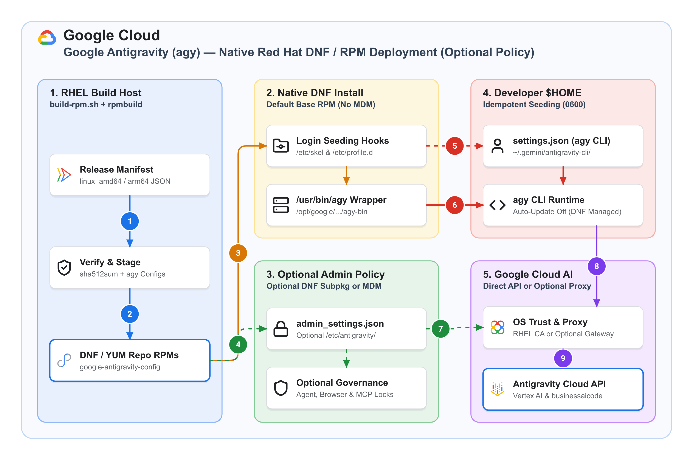

# `antigravity-enterprise-deploy` — Agent Skill

An open-source [Agent Skill](https://agentskills.io) for generating **portable enterprise Linux `.zip` installer bundles (default)**, **Workforce Identity Federation (WIF)** configurations for **Ping Identity (`PingFederate` / `PingOne`) and Okta**, and **optional** native Red Hat `.rpm` packages (`dnf` / `rpmbuild`) for **Google Antigravity (`agy`)**.


## Key Capabilities

- **Default Portable `.zip` Bundle (`scripts/build-bundle.sh`):** Exports `dist/antigravity-enterprise-bundle-linux-<arch>.zip` containing the SHA-512 verified `agy` binary (`bin/agy-bin`), generated `.json` config files (`configs/settings.json` + optional WIF/ADC or `admin_settings.json`), and a standalone `install.sh` bash script (supports zero-`sudo` user install `./install.sh` or `sudo ./install.sh --system`).
- **Workforce Identity Federation (Ping Identity & Okta — OIDC & SAML 2.0):**
  - **Pattern A (Recommended):** 4-line `gcp` block in `~/.gemini/antigravity-cli/settings.json` + native `agy` PKCE WIF browser sign-in (`locations/global/workforcePools/{pool_id}/providers/{provider_id}`) — zero `gcloud` dependency, works identically for **PingFederate**, **PingOne**, and **Okta**.
  - **Pattern B:** Zero-paste `wif-login-config.json` (`gcloud iam workforce-pools create-login-config`) + Application Default Credentials (`AGY_ADC_AUTH="true"` / `enableAdc: true`).
- **Optional OS Package Mode (`scripts/build-rpm.sh`):** Builds a native Red Hat `.rpm` (`dnf` / `yum`) with an opt-in `google-antigravity-admin-policy` subpackage when OS package management is desired.



## Install the Skill

### Google Antigravity (`agy`)

```bash
git clone https://github.com/brookswood/antigravity-enterprise-deploy.git \
  ~/.gemini/config/skills/antigravity-enterprise-deploy
```

### Agent Skills CLI (`npx skills`)

```bash
npx skills add brookswood/antigravity-enterprise-deploy
```

## Quick Start: Export a Portable `.zip` Bundle

```bash
# 1. Default portable .zip (agy binary + settings.json + install.sh; ready for Ping or Okta Pattern A WIF)
./scripts/build-bundle.sh

# 2. Optional Pattern B WIF + ADC .zip (adds wif-login-config.json + config.json + AGY_ADC_AUTH="true")
INCLUDE_WIF_ADC=1 GCP_QUOTA_PROJECT="example-gcp-project" ./scripts/build-bundle.sh

# 3. Optional Red Hat RPM instead of .zip
./scripts/build-rpm.sh
```

## Repository Structure

```text
antigravity-enterprise-deploy/
├── SKILL.md                                  # Router, schema guardrails & precedence map
├── references/
│   ├── wif-authentication.md                 # Ping Identity (PingFederate/PingOne) & Okta WIF guide
│   └── rhel-rpm-packaging.md                 # Optional Red Hat DNF/RPM packaging guide
├── scripts/
│   ├── build-bundle.sh                       # Default exporter: portable .zip (agy + JSONs + install.sh)
│   └── build-rpm.sh                          # Optional exporter: native Red Hat .rpm (rpmbuild)
└── assets/
    ├── google-antigravity-config.spec        # Optional RPM spec (base + optional admin-policy)
    └── configs/
        ├── agy-cli-settings.json             # Template for ~/.gemini/antigravity-cli/settings.json
        ├── wif-login-config.example.json     # Optional Ping/Okta WIF login-config.json template
        ├── user_app_config.json              # Optional ~/.gemini/config/config.json (enableAdc)
        └── admin_settings.json               # Optional /etc/antigravity/admin_settings.json template
```

## License

[Apache-2.0](LICENSE)
