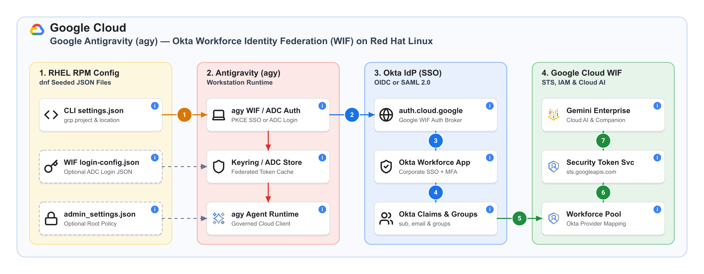

# `antigravity-enterprise-deploy` — Agent Skill

An open-source [Agent Skill](https://agentskills.io) for generating **portable enterprise Linux `.zip` installer bundles (default)**, **1-step Workforce Identity Federation (WIF)** login setups for **Ping Identity (`PingFederate` / `PingOne`) and Okta**, and **optional** native Red Hat `.rpm` packages (`dnf` / `rpmbuild`) for **Google Antigravity (`agy`)** — with **zero `gcloud` CLI required**.



## 1-to-2 Step End-User Login Experience (Zero `gcloud`, Zero Provider String Typing)

When built with `WIF_PROVIDER="locations/global/workforcePools/{pool_id}/providers/{provider_id}"`, `install.sh` pre-seeds `~/.gemini/antigravity-cli/settings.json`, `cache/onboarding.json`, and `antigravity-oauth-token` (`saved_wif_provider`). For end users:

1. **Step 1:** Run `agy` — the pre-selected top choice is already **`> 1. Continue with <ping-or-okta-idp>`**. Press **`Enter`**.
2. **Step 2:** Browser opens automatically and redirects straight to **Ping Identity** or **Okta** SSO + MFA. Done!

## Install the Skill

### Google Antigravity (`agy`)

```bash
git clone https://github.com/brookswood/antigravity-enterprise-deploy.git \
  ~/.gemini/config/skills/antigravity-enterprise-deploy
```

### Agent Skills CLI (`npx skills`)

```bash
npx skills add brookswood/antigravity-enterprise-deploy
```

## Quick Start: Export a Portable `.zip` Bundle

```bash
# 1. Recommended 1-step Ping Identity or Okta WIF .zip (zero gcloud CLI, zero typing by end users)
WIF_PROVIDER="locations/global/workforcePools/example-workforce-pool/providers/ping-sso" \
  ./scripts/build-bundle.sh

# 2. Optional Pattern B WIF + gcloud ADC .zip
INCLUDE_WIF_ADC=1 GCP_QUOTA_PROJECT="example-gcp-project" ./scripts/build-bundle.sh

# 3. Optional Red Hat RPM instead of .zip
WIF_PROVIDER="locations/global/workforcePools/example-workforce-pool/providers/ping-sso" \
  ./scripts/build-rpm.sh
```


## Repository Structure

```text
antigravity-enterprise-deploy/
├── SKILL.md                                    # Router, schema guardrails & precedence map
├── references/
│   ├── wif-authentication.md                   # Ping Identity (PingFederate/PingOne) & Okta WIF guide
│   └── rhel-rpm-packaging.md                   # Optional Red Hat DNF/RPM packaging guide
├── scripts/
│   ├── build-bundle.sh                         # Default exporter: portable .zip (agy + JSONs + install.sh)
│   └── build-rpm.sh                            # Optional exporter: native Red Hat .rpm (rpmbuild)
└── assets/
    ├── google-antigravity-config.spec          # Optional RPM spec (base + optional admin-policy)
    └── configs/
        ├── agy-cli-settings.json               # Template for ~/.gemini/antigravity-cli/settings.json
        ├── onboarding.json                     # Pre-seeds 1-step WIF fast sign-in menu
        ├── wif-provider-seed.example.json      # Pre-seeds saved_wif_provider (Ping or Okta)
        ├── wif-login-config.example.json       # Optional Pattern B gcloud ADC template
        ├── user_app_config.json                # Optional ~/.gemini/config/config.json (enableAdc)
        └── admin_settings.json                 # Optional /etc/antigravity/admin_settings.json template
```

## License

[Apache-2.0](LICENSE)
